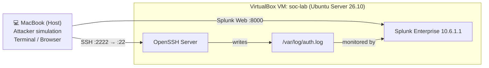
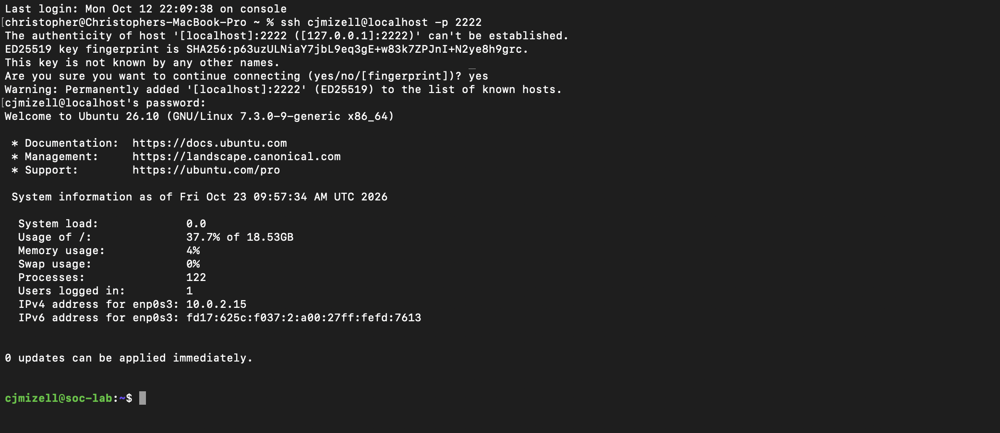
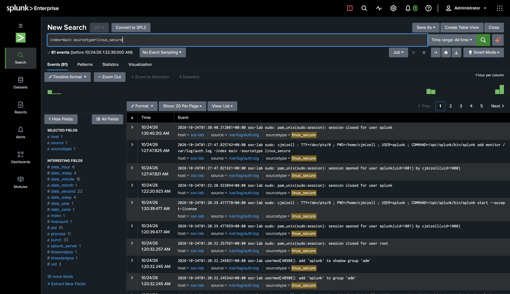
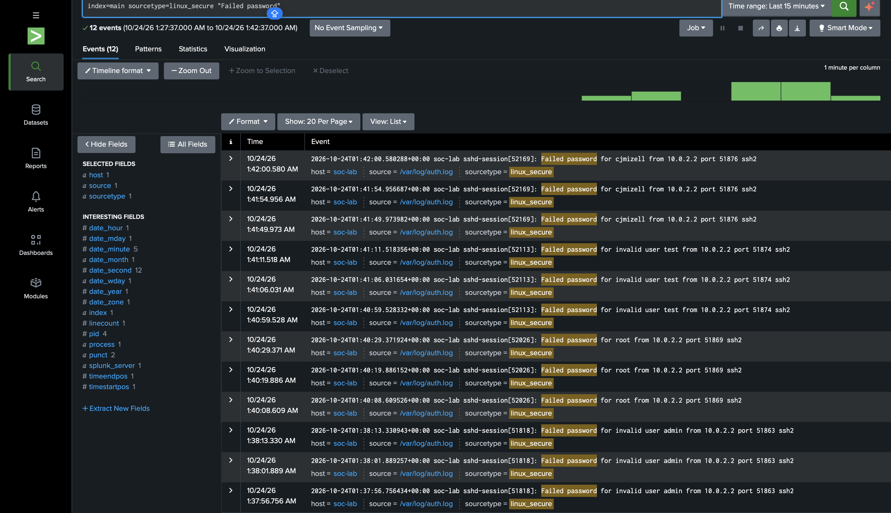
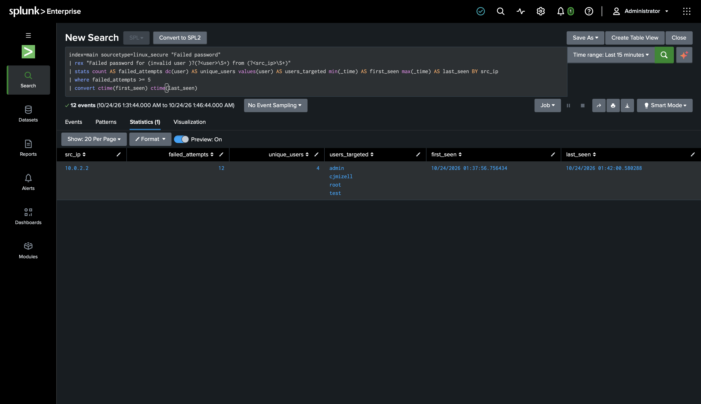
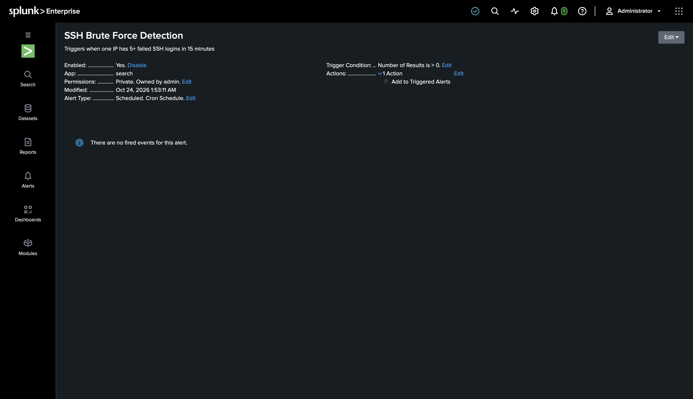
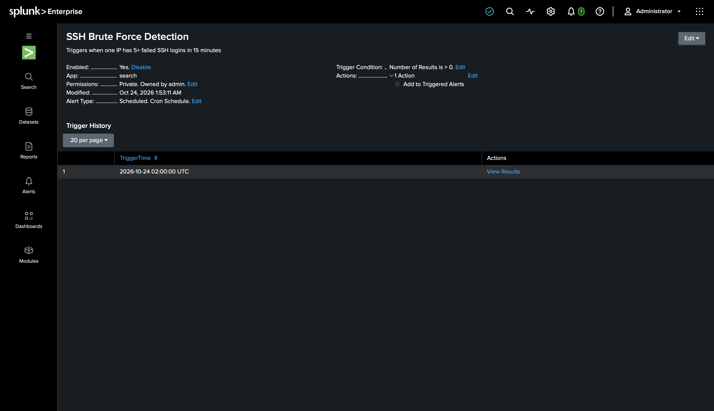
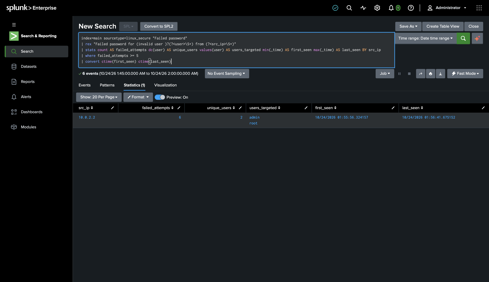

# Home Lab: Detecting SSH Brute-Force Attacks with Splunk

I built a SOC home lab on my own computer: a Linux server that sends its authentication logs to a SIEM (Splunk). Then I ran a simulated password-guessing attack against the server, wrote a detection search to catch it, and turned that search into a scheduled alert.

**Skills:** SIEM deployment · Log ingestion · SPL (Splunk Search Processing Language) · Detection engineering · Linux administration · Virtualization · Incident analysis · MITRE ATT&CK

---

## Lab Architecture



| Component | Details |
|---|---|
| Hypervisor | Oracle VirtualBox 7.2 on an Intel MacBook Pro |
| Server | Ubuntu Server 26.10: 2 vCPU, 6 GB RAM, 40 GB disk |
| SIEM | Splunk Enterprise 10.6.1.1 (60-day trial) |
| Networking | NAT with port forwarding: host 2222 → guest 22 (SSH), host 8000 → guest 8000 (Splunk Web) |
| Log source | `/var/log/auth.log` (sourcetype `linux_secure`) |

> **Note:** Because the VM uses NAT, all traffic from my Mac reaches the VM from **10.0.2.2**, the VirtualBox NAT gateway. In this lab, 10.0.2.2 is the "attacker" IP.

---

## Phase 1: Build the Server

- Created the Ubuntu Server VM in VirtualBox and installed the **OpenSSH server**.
- Set up NAT port forwarding so my Mac could reach SSH and Splunk Web.
- Expanded the logical volume to use the full 40 GB disk (`lvextend -r -l +100%FREE`), since the installer only allocated about 18.5 GB by default.
- Confirmed remote access from the host with `ssh cjmizell@localhost -p 2222`.



## Phase 2: Deploy Splunk and Ingest Logs

- Installed Splunk Enterprise from the `.deb` package.
- **Ran Splunk as a dedicated, non-root `splunk` user** (least privilege). I also added that user to the `adm` group so it could read system logs without full root access.
- Configured Splunk to monitor the authentication log:

```bash
sudo -u splunk /opt/splunk/bin/splunk add monitor /var/log/auth.log -index main -sourcetype linux_secure
```

- Verified ingestion in Splunk: **81 events** indexed. These included my own `sudo` and `usermod` admin activity, which shows that privileged actions on the server leave an audit trail.



## Phase 3: Simulate the Attack

From my Mac, I made repeated SSH login attempts with wrong passwords against four usernames. Attackers commonly try default and privileged accounts such as `admin`, `root` and `test`. I also targeted one real account, `cjmizell`.

```bash
ssh admin@localhost -p 2222     # wrong password x3
ssh root@localhost -p 2222      # wrong password x3
ssh test@localhost -p 2222      # wrong password x3
ssh cjmizell@localhost -p 2222  # wrong password x3
```

Splunk captured all **12 failed logins**:

```
index=main sourcetype=linux_secure "Failed password"
```



**Analyst observation:** the logs separate `Failed password for invalid user admin` (the account doesn't exist) from `Failed password for root` (the account **exists**). An analyst cares about this difference, because failed attempts against valid accounts mean the attacker has found real usernames.

## Phase 4: Build the Detection

I wrote an SPL search that pulls the username and source IP out of each event, groups the failures by source IP, and flags any IP with **5 or more** failed logins:

```spl
index=main sourcetype=linux_secure "Failed password"
| rex "Failed password for (invalid user )?(?<user>\S+) from (?<src_ip>\S+)"
| stats count AS failed_attempts dc(user) AS unique_users values(user) AS users_targeted min(_time) AS first_seen max(_time) AS last_seen BY src_ip
| where failed_attempts >= 5
| convert ctime(first_seen) ctime(last_seen)
```

| Line | Purpose |
|---|---|
| `rex` | Extracts `user` and `src_ip` from the raw log text |
| `stats ... BY src_ip` | Counts failures per IP, how many accounts were targeted, and the attack's time window |
| `where failed_attempts >= 5` | Detection threshold |
| `convert ctime(...)` | Converts timestamps to readable times |

**Result:**

| src_ip | failed_attempts | unique_users | users_targeted | first_seen | last_seen |
|---|---|---|---|---|---|
| 10.0.2.2 | 12 | 4 | admin, cjmizell, root, test | 2026-10-24 01:37:56 | 2026-10-24 01:42:00 |



## Phase 5: Automate It as an Alert

I saved the search as a scheduled alert so the attack is detected without anyone running the search by hand:

| Setting | Value |
|---|---|
| Name | SSH Brute Force Detection |
| Schedule | Every 15 minutes (`*/15 * * * *`), searching the last 15 minutes |
| Trigger | Number of results > 0 |
| Action | Add to Triggered Alerts, severity **High** |



To test it, I ran a second round of failed logins. The alert **fired automatically on its next scheduled run, at 2026-10-24 02:00:00 UTC**, with no manual searching needed.



The alert's results show the second attack within its 15-minute window (01:45–02:00):

| src_ip | failed_attempts | unique_users | users_targeted | first_seen | last_seen |
|---|---|---|---|---|---|
| 10.0.2.2 | 6 | 2 | admin, root | 01:55:56 | 01:56:41 |



---

## Incident Summary

| Field | Finding |
|---|---|
| **What** | SSH password-guessing (brute-force) attack |
| **Source** | 10.0.2.2 |
| **Target** | soc-lab (Ubuntu server), SSH port 22 |
| **Accounts targeted** | admin, test (invalid), root, cjmizell (valid) |
| **Volume** | 12 failed attempts in about 4 minutes |
| **Outcome** | No successful logins from the attacking IP during the attack window |
| **MITRE ATT&CK** | [T1110.001: Brute Force: Password Guessing](https://attack.mitre.org/techniques/T1110/001/) |

### Recommended Response

1. **Contain:** block the source IP at the firewall, or automatically ban repeat offenders with a tool like `fail2ban`.
2. **Verify:** search for any **successful** login (`"Accepted password"`) from the same IP to confirm no account was compromised.
3. **Harden:**
   - Disable root login over SSH (`PermitRootLogin no`).
   - Switch to SSH key authentication and disable password logins.
   - Limit SSH access to trusted IPs.
4. **Monitor:** keep the alert running, and tune the threshold to the environment's normal login behavior to reduce false positives.

---

## What I Learned

- **The full detection pipeline:** a log source, ingestion, a search, an alert and a response. Each step depends on the one before it.
- **Least privilege applies to tools too.** Splunk 10 warns against running as root, so I ran it under a dedicated service account with only the group access it needed.
- **Logs carry analyst context.** "Invalid user" versus a valid account changes how serious the incident is.
- **Detections need tuning.** A threshold of 5 failures in 15 minutes catches this attack, but in production it would be adjusted to avoid alerts from users who simply mistype their passwords.
- **Troubleshooting is part of the job.** I worked through a corrupted VM saved state, Ubuntu's socket-activated SSH service, a partially allocated disk and Splunk's non-root requirement.

## Next Steps

- Add a Windows VM and ingest Windows Event Logs (Event IDs 4625 and 4624)
- Install `fail2ban` and confirm Splunk logs the automatic IP bans
- Build a Splunk dashboard showing failed logins over time
- Write a second detection for a **successful login after multiple failures**, a strong sign of compromise
