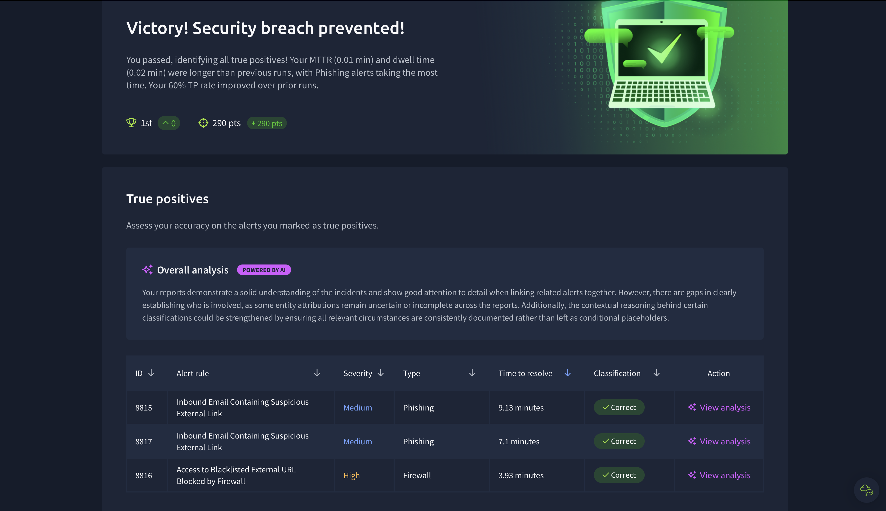

# SOC Investigations

Hands-on alert triage in a simulated Security Operations Center (SOC). Each investigation follows the analyst workflow: **triage the alert → gather evidence → correlate related alerts → classify (True/False Positive) → document and recommend remediation.**

---

## Scenario 1: Introduction to Phishing (TryHackMe SOC Simulator)

**Result:** ✅ Passed. All true positives identified and correctly classified.

**Tools:** SIEM alert queue, TryDetectThis (threat intelligence), firewall logs

**Skills:** Phishing analysis, threat intel lookups, alert correlation, incident reporting

### Alert Summary

| Alert | Type | Verdict | Time to Resolve | Key Finding |
|---|---|---|---|---|
| 8814 | Phishing | False Positive | — | Legitimate HR onboarding email from a clean, matching domain |
| 8815 | Phishing | **True Positive** ✅ | 9.13 min | Amazon impersonation via look-alike domain and URL shortener |
| 8816 | Firewall | **True Positive** ✅ | 3.93 min | User clicked the 8815 phishing link; firewall blocked the connection |
| 8817 | Phishing | **True Positive** ✅ | 7.1 min | Microsoft credential-harvesting email using a typosquatted domain |

✅ = classification graded **Correct** by the simulator

---

### Alert 8814: Suspicious External Link (False Positive)

- **Sender:** onboarding@hrconnex.thm → **Recipient:** j.garcia@thetrydaily.thm
- **Subject:** "Action Required: Finalize Your Onboarding Profile"
- **Evidence:** The link domain matched the sender domain, there was no attachment, the content matched a real onboarding event, and threat intelligence showed the domain as **clean**.
- **Verdict:** Legitimate vendor email. Closed as a **False Positive**.
- **Recommendation:** Add hrconnex.thm as a trusted HR vendor domain to reduce alert noise.

### Alert 8815: Amazon Delivery Phishing (True Positive)

- **Sender:** urgents@**amazon.biz** → **Recipient:** h.harris@thetrydaily.thm
- **Subject:** "Your Amazon Package Couldn't Be Delivered – Action Required"
- **Red flags:**
  - Look-alike domain (amazon.biz, not amazon.com)
  - Shortened HTTP link (`bit.ly`) hiding the real destination
  - Generic "Dear Customer" greeting and a 48-hour urgency deadline
- **Key lesson:** Threat intel returned **clean**, but the indicators clearly showed phishing. New phishing domains are often not yet blacklisted, so analysts can't rely on reputation alone.
- **Correlation:** Firewall alert 8816 showed an internal host requested this exact URL about **one minute after delivery**, which means the user clicked.
- **Verdict:** **True Positive.** No escalation needed, because the firewall blocked the connection.
- **Remediation:** Remove the email, block amazon.biz and the URL, confirm the host owner, and provide phishing awareness training.

### Alert 8816: Blacklisted URL Blocked by Firewall (True Positive)

- **Source:** 10.20.2.17:34257 → **Destination:** 67.199.248.11:80
- **URL:** `http://bit.ly/3sHkX3da12340` (the same link as alert 8815)
- **Action:** **Blocked** by the firewall rule "Blocked Websites"
- **Verdict:** **True Positive.** A real user attempted to reach a phishing URL. Existing controls contained it, so no compromise occurred.

### Alert 8817: Microsoft Credential Phishing (True Positive)

- **Sender:** no-reply@**m1crosoftsupport.co** → **Recipient:** c.allen@thetrydaily.thm
- **Subject:** "Unusual Sign-In Activity on Your Microsoft Account"
- **Red flags:**
  - Typosquatted domain ("m**1**crosoft", with `.co` instead of `.com`)
  - Fear-based lure (a fake sign-in alert from Lagos, Nigeria)
  - Link to a fake login page (`/login`) designed to harvest credentials
- **Network details:** Affected user host **10.20.2.25**; phishing domain IP **45.148.10.131**
- **Verdict:** **True Positive** credential-harvesting attempt.
- **Remediation:** Remove the email from all mailboxes, block the domain and 45.148.10.131, reset the user's password, revoke active sessions, enforce MFA, and provide phishing awareness training.
- **Feedback I applied:** My original report left the click status as an open question. A complete report should state, based on firewall/proxy logs, whether the host connected to the phishing domain and whether the connection was allowed or blocked. I now confirm user activity in the logs before closing an alert.

---

### Indicators of Compromise (IOCs)

| Type | Indicator |
|---|---|
| Domain | amazon.biz |
| Domain | m1crosoftsupport.co |
| URL | http://bit.ly/3sHkX3da12340 |
| URL | https://m1crosoftsupport.co/login |
| IP | 67.199.248.11 (bit.ly destination) |
| IP | 45.148.10.131 (m1crosoftsupport.co) |

### What I Learned

- **Correlating alerts tells the full story.** Linking the email (8815) to the firewall block (8816) showed the user clicked the link and the attack was stopped.
- **Threat intel is one input, not the answer.** A "clean" result doesn't make a domain safe.
- **Confirm entities before reporting.** Verifying which user owns an IP address, instead of assuming, makes reports stronger.
- **Reports must be definitive.** Every report should state concrete findings from the logs (who, where, allowed or blocked), not "if/or" placeholders.
- **Not every alert is malicious.** Investigating instead of guessing avoids wasting time on false positives.
